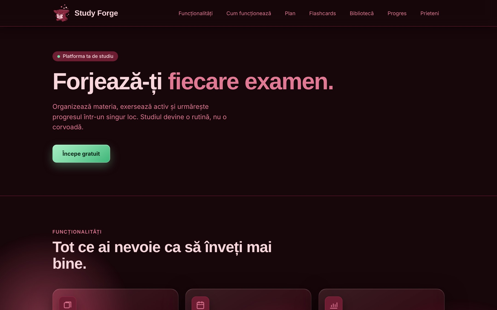
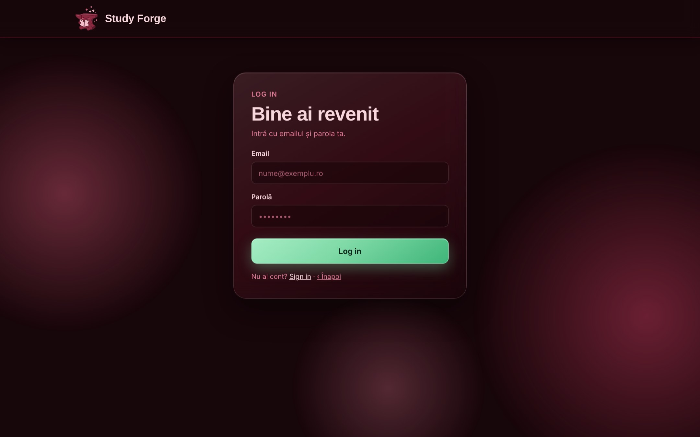
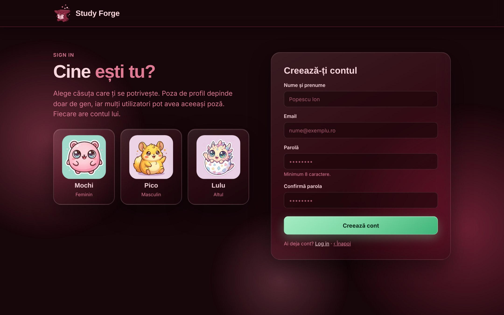
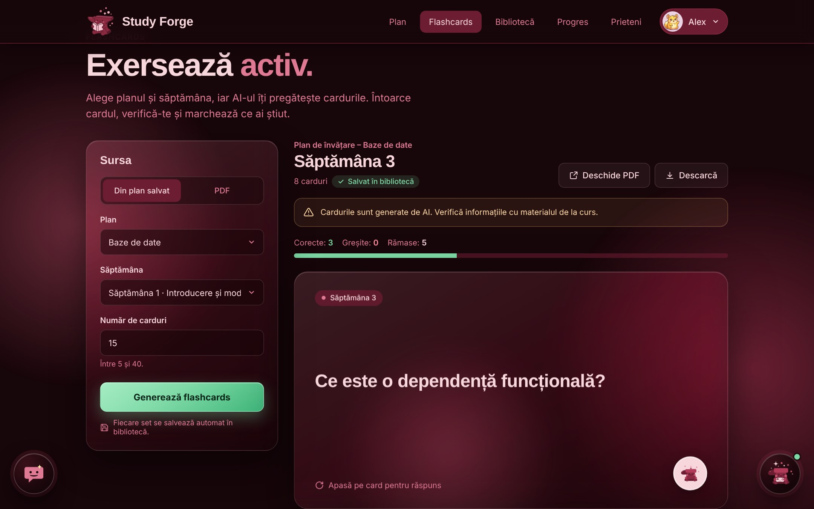
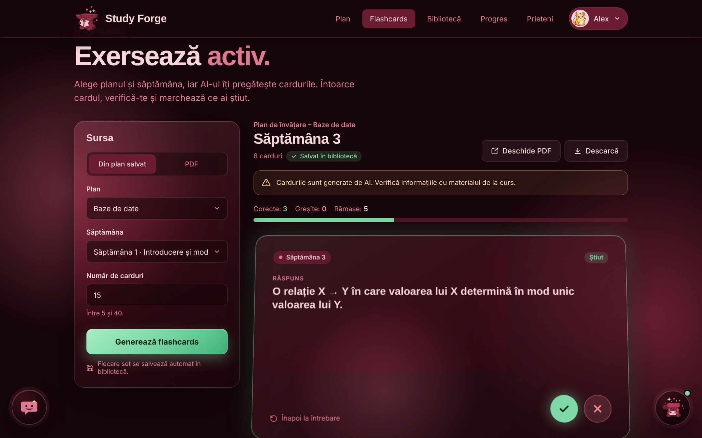
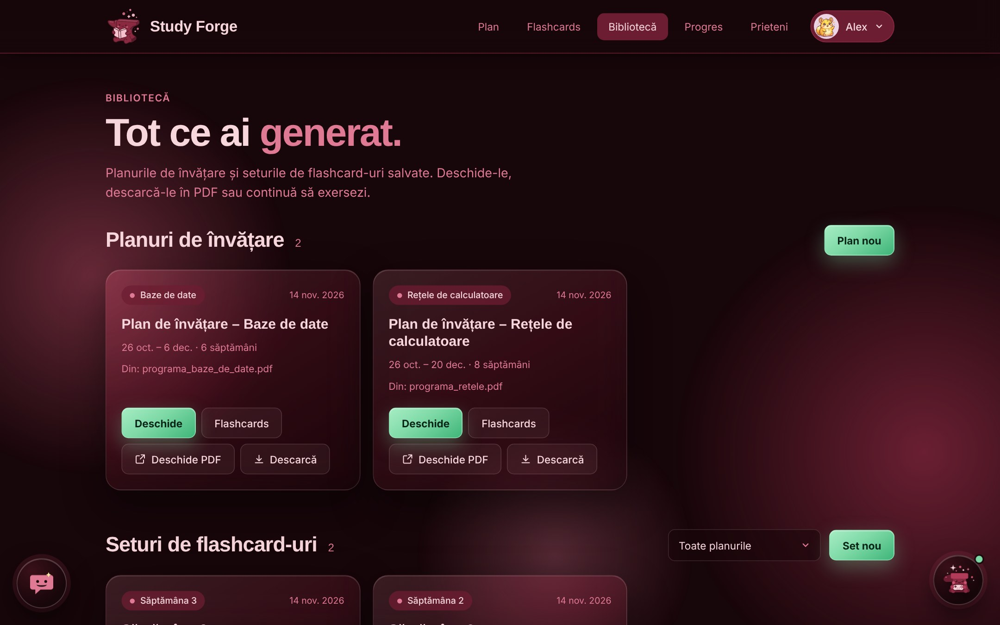
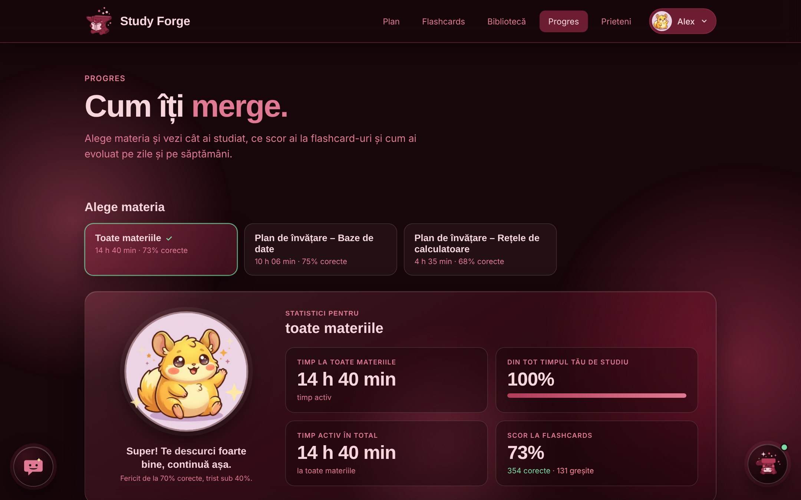

# 😎 StudyForge

> *Forge every exam. An AI-powered study platform that turns your syllabus into a weekly plan, flashcards and measurable progress.*

---

## 📸 Sneak Peek

### Welcome Page


### Login / Register



### Learning Plan


### Flashcards



### Library



### Progress Page


### Friends & Leaderboard


---

## ✨ Key Features

- [x] **Authentication:** Create an account (pick an avatar: Mochi, Pico or Lulu) and log in securely with a JWT valid for 7 days.
- [x] **AI Learning Plan:** Upload your syllabus as a PDF (up to 20 MB), optionally set a start date, and Gemini splits the subject into weeks with topics, tasks and exam dates.
- [x] **PDF Export:** Every plan and flashcard set is saved and can be opened or downloaded as a PDF.
- [x] **AI Flashcards:** Generate flashcards for the current week (from a saved plan or a PDF), flip them, and mark each one as *known* or *to review*.
- [x] **Hints:** Stuck on a card? Ask the mascot for a hint without revealing the answer.
- [x] **Library:** Browse all saved plans and flashcard sets, with quick actions to open, study or download them.
- [x] **Subject Jokes:** Let Gemini write a (slightly passive-aggressive) joke about the subject you're studying.
- [x] **Progress Tracking:** Active study time, flashcard score and evolution by day or by week, per subject, synced with the server. The mascot's mood changes with your score.
- [x] **Friends & Leaderboard:** Add friends by email, accept or decline requests, compare weekly results in a leaderboard and react with like / dislike. Browse previous weeks.
- [x] **Flappy Forge:** A small built-in mini-game for study breaks.

---

## 📁 Project Structure

A high-level overview of the project's architecture:

```text
📦 StudyForge
├── 📂 backend                              # Spring Boot application
│   ├── 📂 src/main/java/com/studyforge/backend
│   │   ├── 📂 ai                           # Gemini client, prompts & JSON schemas
│   │   ├── 📂 auth                         # Users, registration, login & JWT
│   │   ├── 📂 common                       # Shared helpers & global exception handling
│   │   ├── 📂 config                       # Security, CORS & app properties
│   │   ├── 📂 joke                         # AI-generated subject jokes
│   │   ├── 📂 library                      # Saved plans & flashcard sets
│   │   ├── 📂 pdf                          # PDF text extraction & PDF rendering
│   │   ├── 📂 plan                         # Learning plans (entity, service, controller)
│   │   ├── 📂 progress                     # Study time, scores & weekly stats
│   │   ├── 📂 quiz                         # Flashcards, quizzes & hints
│   │   ├── 📂 social                       # Friends, reactions & leaderboard
│   │   └── 📂 storage                      # Uploaded PDF storage
│   ├── 📂 src/main/resources               # application.yaml, fonts & db/migration scripts (Flyway)
│   ├── 📂 src/test                         # Tests (JUnit)
│   ├── 📄 Dockerfile                       # Backend container image
│   └── 📄 pom.xml                          # Maven dependencies
├── 📂 frontend                             # React & Vite application
│   ├── 📂 public                           # Static assets
│   ├── 📂 src
│   │   ├── 📂 auth                         # Auth context & avatars
│   │   ├── 📂 components                   # Reusable UI components (charts, mascot, topbar)
│   │   ├── 📂 extras                       # Flappy Forge mini-game & joke bubble
│   │   ├── 📂 hooks                        # Custom hooks
│   │   ├── 📂 pages                        # Welcome, Login, Register, Plan, Flashcards, Library, Progress, Friends
│   │   ├── 📂 progress                     # Local progress store & server sync
│   │   ├── 📂 router                       # Custom client-side router
│   │   ├── 📂 styles                       # Hand-written CSS
│   │   └── 📂 toast                        # Notification system
│   ├── 📄 package.json                     # Frontend dependencies and scripts
│   └── 📄 vite.config.js                   # Vite configuration (proxies /api to the backend)
├── 📂 web_pics                             # Images used for documentation
├── 📄 docker-compose.yml                   # Database + backend container setup
└── 📄 .env.example                         # Environment variables template
```

---

## 🛠️ Tech Stack

### Backend


### AI & Documents


### Database & DevOps


### Frontend


### Tools


---

## 🚀 Getting Started

### Prerequisites

- [Docker](https://www.docker.com/) (running)
- Java 25 (only if you run the backend outside Docker)
- Node.js and npm
- A [Google Gemini API key](https://aistudio.google.com/apikey)

### Run the app

1. **Clone the repository**
   ```bash
   git clone https://github.com/<your-username>/StudyForge.git
   cd StudyForge
   ```

2. **Create your `.env` file** in the root folder, based on `.env.example`
   ```bash
   cp .env.example .env
   ```
   Then fill in the values: database name, user and password, your `GEMINI_API_KEY`, and a `JWT_SECRET` of at least 32 characters.

3. **Start the database and the backend**
   ```bash
   docker compose up -d --build
   ```
   This starts PostgreSQL (port `5432`) and the Spring Boot API (port `8080`). Flyway creates the tables automatically.

   *Prefer running the backend from your IDE?* Start only the database with `docker compose up -d postgres`, then run `BackendApplication` (`backend/src/main/java/com/studyforge/backend`), or from the terminal:
   ```bash
   cd backend
   ./mvnw spring-boot:run
   ```
   Make sure the variables from `.env` are available to the backend in this case.

4. **Start the frontend** (in a new terminal)
   ```bash
   cd frontend
   npm install
   npm run dev
   ```

5. **Open the app** at http://localhost:5173

Now you're good to go: upload your syllabus and start forging your exams! 🔥

---

## 👤 Authors
1. [Iordaconiu Alexandra](https://github.com/ale7271) 
2. [Rebigea Natalia](https://github.com/nataliarebigea)
3. [Stefanescu Alexandru](https://github.com/Alexandru005)
